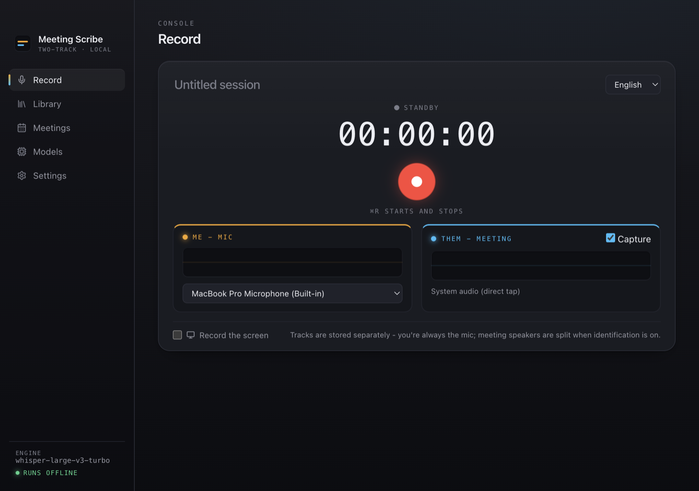
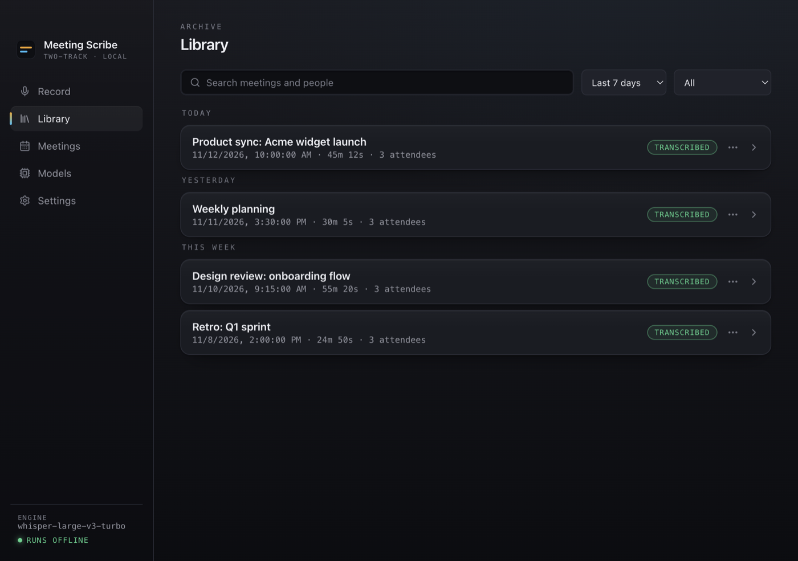
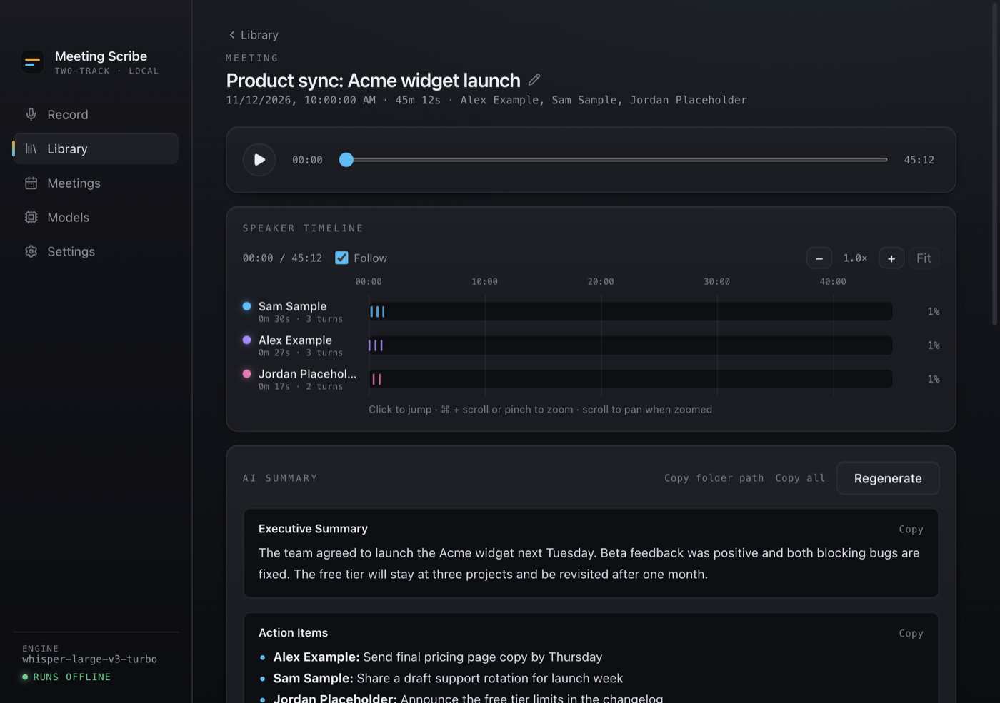
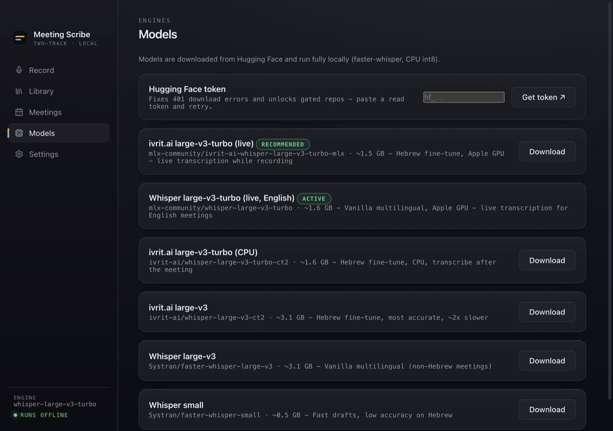
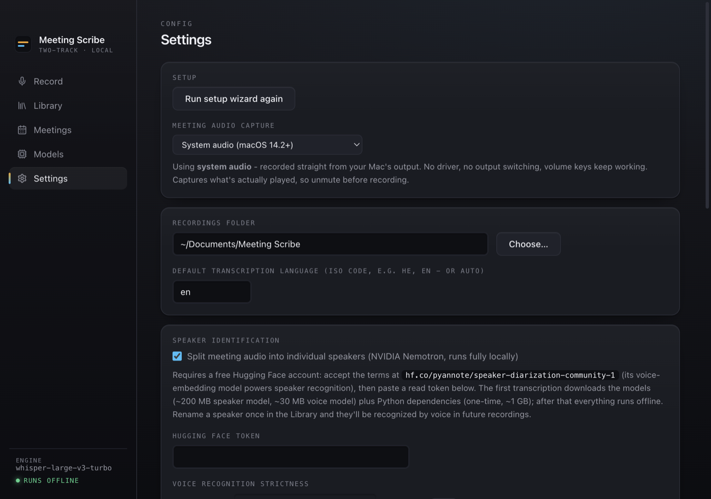
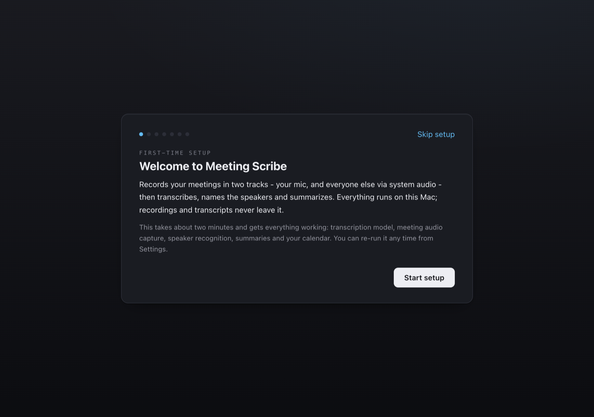

# Meeting Scribe

Local meeting recorder + transcriber for macOS. Records two tracks - your mic, and everyone else via a direct system-audio tap - then transcribes (Hebrew via [ivrit.ai](https://www.ivrit.ai/) fine-tunes, English and more via Whisper), identifies who said what, and writes a summary. Everything runs on your Mac; recordings and transcripts never leave it (summaries optionally go through an AI command-line tool you already use, Claude Code or Codex - or turn on offline mode and nothing touches the network at all).

## Screenshots

The screenshots below use made-up demo data.













## Install

```bash
git clone https://github.com/raskanskyz/meeting-scribe.git meeting-scribe
cd meeting-scribe
./scripts/setup.sh
```

That's the whole install. The script installs the system dependencies, builds the app, puts **Meeting Scribe.app** in /Applications and launches it. The script is idempotent - if it fails partway (e.g. missing Xcode Command Line Tools or Homebrew), fix what its error message says and re-run it. The in-app setup wizard walks you through the rest: transcription model, meeting-audio capture, speaker recognition, summaries and calendar.

## What setup.sh installs

| Dependency           | Why                                                                                                |
| -------------------- | -------------------------------------------------------------------------------------------------- |
| uv                   | Runs the Python transcription sidecar (faster-whisper / MLX / pyannote), which manages its own env |
| node                 | Builds the Electron app                                                                            |

On macOS 14.2+ (the default path) the app taps system audio directly - no audio driver, no password, no output switching, and the volume keys keep working while recording. macOS asks once to allow system-audio recording.

**Legacy BlackHole route (macOS older than 14.2 only):** setup.sh additionally installs [BlackHole 2ch](https://github.com/ExistentialAudio/BlackHole), asks for your password once (audio driver, restarts coreaudiod), and the app creates the "Meeting Scribe" Multi-Output Device (speakers + BlackHole) itself. It can also be forced on newer macOS under Settings → Meeting audio capture. Speaker identification still needs macOS 14+.

## Features

- **Two-track audio** - your mic ("Me") and the meeting's system audio ("Them",
  via a direct system-audio tap; BlackHole only as a legacy fallback) are recorded
  as separate `.webm` files, so who-said-what never mixes.
- **Screen recording** - on by default; capture the full screen or a specific
  window (browser, Slack, Zoom…), saved as `screen.webm` with the meeting's
  sound mixed in, playable from the meeting page.
- **Live transcription** - while recording, an MLX (Apple GPU) sidecar streams
  a rolling transcript to the UI. Hebrew uses the ivrit.ai large-v3-turbo
  fine-tune; English uses vanilla Whisper large-v3-turbo.
- **Batch transcription** - after the meeting the full tracks are re-transcribed
  with whole-file context (faster-whisper on CPU or mlx-whisper on GPU), which
  beats the live path's chunked output. Hallucination gating filters
  silence-decoded filler.
- **Speaker identification** - NVIDIA Nemotron 3 Diarization (CoreML, via a
  FluidAudio Swift sidecar) splits the meeting track into up to 8 speakers;
  a voiceprint registry (pyannote embeddings) auto-names people it has heard
  before, and renaming a speaker once enrolls them for future meetings.
- **AI polish & summaries** - if a supported AI CLI is installed
  ([Claude Code](https://claude.com/claude-code) or
  [Codex](https://developers.openai.com/codex/cli)), transcripts get an
  error-correction sweep and a summary (exec summary, action items, decisions,
  open questions - each with one-click copy). Uses your own login for that tool;
  no API key. The setup wizard and Settings detect what is installed, let you
  pick one (preselected when it is the only one), and have a Test button, since
  installed does not mean signed in. Adding another tool is one adapter file in
  `src/main/providers/`. _Copy folder path_ copies the meeting's folder
  (transcript + summary) as an absolute path, handy for pointing an agent at it.
- **Screen context (opt-in, off by default)** - polish and summaries can also
  use up to 10 screenshots of the screen recording, taken when the picture
  changed, plus the text read from them on-device with Apple Vision. Turn it on
  in Settings → Privacy or in the setup wizard. See [Privacy](#privacy).
- **Calendar aware** - a Swift EventKit sidecar lists upcoming meetings,
  prefills the title and invitees, and notifies you two minutes before a
  meeting starts.
- **Menu-bar app** - start/stop from the tray or ⌘R; the window can be closed
  while recording continues. (BlackHole route only: the output device
  auto-switches during recording and is restored afterwards.)
- **Offline mode** - nothing leaves your Mac: hard-disables model downloads and
  Claude; sidecars run with `HF_HUB_OFFLINE=1`. Toggle it from the bottom of the
  sidebar or Settings > Privacy. Recordings are still saved locally; ones made
  while it is on get no polish or summary - generate them by hand later.
- **Disk reclaim** - optionally delete raw audio once the transcript (and
  polish/summary, when enabled) is safely on disk.

## Requirements

- Apple Silicon Mac, macOS 14.2+ (14+ is the floor for speaker identification, 14.2+ for
  driver-free meeting audio; MLX live transcription is GPU-only; batch
  faster-whisper works on CPU)
- Xcode Command Line Tools (`xcode-select --install`) and [Homebrew](https://brew.sh) - setup.sh checks and tells you if they're missing
- For speaker identification: a free Hugging Face account (the wizard links you through it)
- For summaries: [Claude Code](https://claude.com/claude-code) or [Codex](https://developers.openai.com/codex/cli) CLI, signed in
- Permissions (macOS prompts on first use): microphone; Screen & System Audio Recording (system-audio tap for the meeting track, and the optional screen video); calendar

## Development

```bash
npm run dev          # hot-reload dev app
npm run typecheck
npm test             # main-process unit tests only (src/main/*.test.mjs, node --test)
npm run pack         # sidecars + electron-builder .app under dist.noindex/ (.noindex keeps build copies out of Spotlight)
npm run install:app  # pack + reinstall to /Applications
npm run package:share  # zip with DMG + INSTALL.txt for sharing with peers (unsigned, no notarization)
```

`npm test` does not run the tests under `tests/`. Run those separately:

```bash
node tests/download.test.ts          # likewise media.test.ts, summaryClipboard.test.ts, timelineView.test.ts
uv run --with numpy python tests/test_mic_speakers.py   # likewise test_mlx_vad.py
```

## How it works

```
renderer (React)                    main (Electron)              sidecars
────────────────                    ───────────────              ────────
getUserMedia mic + system tap ──►   rec:append ──► <track>.webm
getUserMedia screen (desktop) ──►   rec:append ──► screen.webm
16 kHz PCM tap (live)         ──►   rec:feedPcm ─────────────►   python/stream.py   (MLX + Silero VAD)
                                    rec:finish  ─────────────►   python/transcribe.py (whisper + swift/diarize-sidecar)
                                                └────────────►   claude / codex exec … (polish + summary)
                                    calendar:upcoming ────────►  swift/calendar-sidecar  (EventKit)
                                    (BlackHole route only)
                                    multi-out + output switch ►  swift/audio-sidecar     (CoreAudio)
                                    setup wizard status/heal ─►  swift/audiosetup-sidecar (CoreAudio)
                                    screen context (opt-in) ──►  swift/ocr-sidecar       (Vision OCR)
```

Each recording is a folder in the recordings directory (Settings → Storage):

```
2026-07-28T10-30-00/
  mic.webm            # you
  system.webm         # them (system-audio tap)
  screen.webm         # optional screen video (with mixed audio)
  live.json           # live-transcription preview segments
  transcript.json/.md # final transcript (post-diarization, post-polish)
  transcript.raw.json # untouched ASR output, kept before the first polish
  speakers.json       # diarization clusters + voiceprint matches
  summary.json        # Claude summary
  meta.json           # title, duration, attendees, timestamps
```

## Troubleshooting

- **Meeting track is silent** - check your Mac isn't muted (the tap records post-volume audio) and that Meeting Scribe is allowed under Privacy & Security → Screen & System Audio Recording. BlackHole route only: sound output must be the "Meeting Scribe" multi-output device (the app switches automatically); if it is stale after changing speakers, use Settings → _Rebuild audio device for current speakers_.
- **Diarization fails with 401** - your Hugging Face token is invalid **or** you haven't accepted the model terms at [hf.co/pyannote/speaker-diarization-community-1](https://huggingface.co/pyannote/speaker-diarization-community-1). Validate the token in the setup wizard (Settings → _Run setup wizard again_) to see which one it is.
- **Player shows 00:00/00:00 after recording** - the transcription model isn't downloaded yet; grab it from the Models tab. No audio is lost.
- **BlackHole missing after install (BlackHole route only)** - the audio system caches devices; `sudo killall coreaudiod` (setup.sh and the in-app installer do this for you).
- **"CLI not found" for Claude Code or Codex** - Settings → AI polish and summaries lists what was found. The app probes PATH, common install dirs and a login shell; after installing, hit _Check again_ (it also re-checks when the window regains focus), or set the binary path by hand.
- **Installed but polish or summary fails** - installed does not mean signed in. Use _Test_ in Settings to send a tiny prompt and see the tool's own error, then run `claude` or `codex login` in a terminal. A wrong model name shows up the same way; leave the model empty for Codex to use its default.
- **Screenshots with Codex** - screen context sends screenshots to Codex as attached images (`codex exec --image`), the same opt-in as for Claude Code.

## Privacy

Recording, transcription, and diarization run entirely on-device. Network is
used only to download models from Hugging Face and, if enabled, to run AI
polish/summaries through the CLI you picked (Claude Code or Codex) - and offline mode
turns both off.

**Screen context is the exception to "transcript only".** If you enable it, the
screenshots (JPEG, up to 1280 px wide) and the text recognized in them are sent
to the AI tool along with the transcript, for meetings that have a `screen.webm`.
A shared screen can show other people's information (chats, documents, emails),
and that goes along too. The frames live in a temp folder that is deleted
afterwards, text recognition runs locally, and nothing is sent when the feature
is off, the meeting has no screen recording, or offline mode is on.

## License

[MIT](LICENSE)
